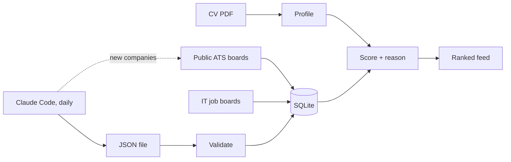

# Job Radar

Upload your CV once, get a ranked feed of matching IT jobs every morning. Jobs come from companies' own career pages and from IT job boards, for Vietnam and remote work.

> **Status:** v2 rewrite, just started. Nothing below is built yet; this README is the plan.

## What it will do

- **Read the CV locally.** Upload a PDF; the app pulls out skills, seniority and location, and you can edit the profile.
- **Find jobs at the source.** Many companies publish their openings through public applicant-tracking boards (Greenhouse, Lever, Ashby, Workable, SmartRecruiters). The app reads those directly, so links point to the company itself.
- **Cover the boards too.** Vietnamese IT boards (TopDev, Vieclam24h, CareerLink, CareerViet) and remote boards (RemoteOK, Arbeitnow, We Work Remotely, HN "Who is hiring").
- **Search the web once a day.** A headless Claude Code run looks for official career pages that match the profile and records which board each company uses, so the next crawl reads that company for free.
- **Rank with a reason.** Each job gets a 0–100 score computed locally (skills, seniority, location, salary, freshness) with a short "matches / missing" explanation. The same job posted in several places is shown once, preferring the official link.
- **Track applications.** Saved → applied → interview → offer or rejected, with notes.

## How it fits together

## Rules for sources

Only public APIs, RSS feeds and pages that `robots.txt` allows. At most one request per second per host. No bypassing logins, CAPTCHAs or Cloudflare challenges. The review of each source (robots, terms, what is blocked) is in [docs/sources.md](docs/sources.md).

## Stack

- Next.js (TypeScript) for the app and the crawler scripts
- SQLite through Node's built-in `node:sqlite`
- Claude Code in headless mode on an existing Claude Pro plan, scheduled once a day with `launchd`
- Runs locally. No paid APIs, no hosting cost

## Roadmap

- [ ] CV upload and profile review
- [ ] ATS sources (Greenhouse, Lever, Ashby, Workable, SmartRecruiters)
- [ ] Vietnamese and remote board sources
- [ ] Dedupe and scoring with reasons
- [ ] Job feed and profile UI
- [ ] Daily Claude Code search and import
- [ ] Daily schedule
- [ ] Application tracker
- [ ] Skill gap view, hide companies, company watchlist

## Part of

The "Now" section of my [portfolio](https://finn-ngn.vercel.app).
