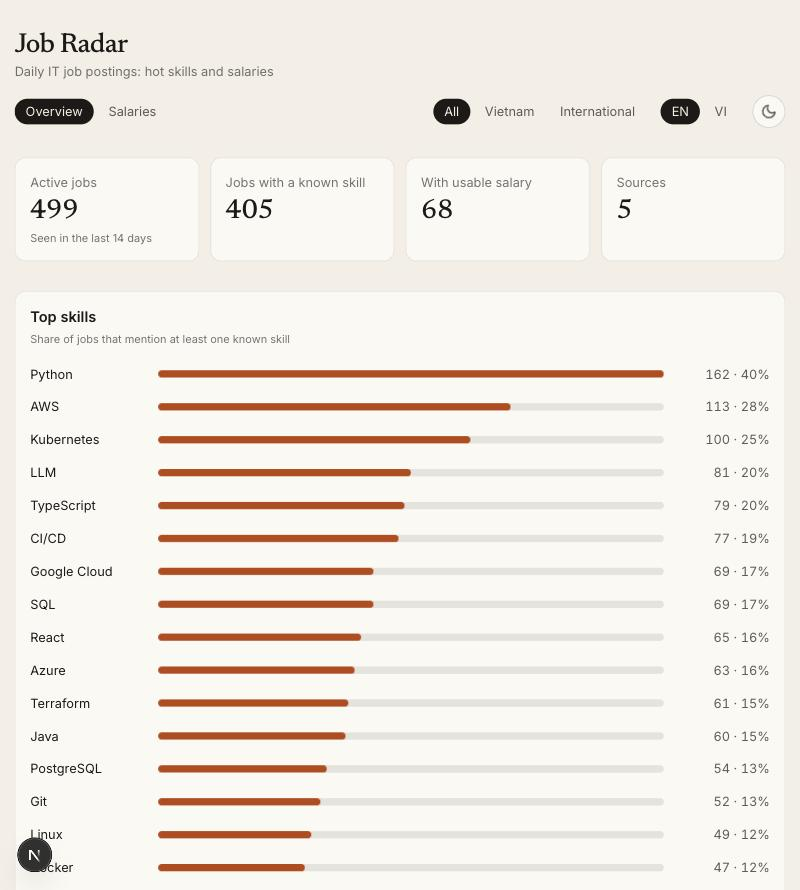
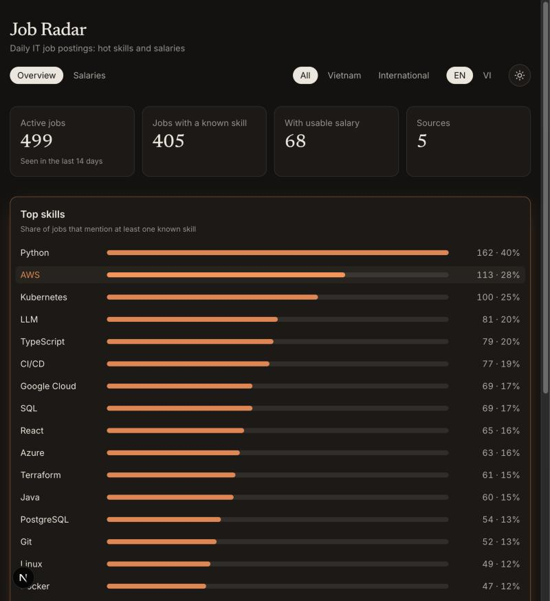
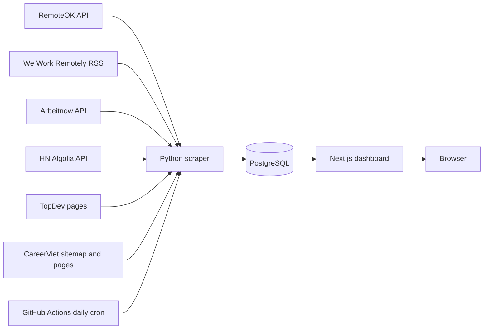

# IT Job Radar

Scrapes IT job postings every day from Vietnamese and international job boards, and turns them into a bilingual dashboard of **which skills are in demand** and **what they pay**.


<p>
  
  
</p>

**Live demo:** TODO (not deployed yet; the deployment steps are in [docs/deploy.md](docs/deploy.md)).

## Highlights

- **Six sources, two regions.** RemoteOK, We Work Remotely, Arbeitnow and Hacker News "Who is hiring?" for international jobs, TopDev and CareerViet for Vietnam. Adding a source means adding one file.
- **Skills and salaries out of free text.** A 72-skill dictionary and a salary parser that reads `25-35 triệu`, `1.500 - 2.000 USD/tháng` and `$120–150k`.
- **Safe to re-run.** Postings are de-duplicated and keep their first-seen and last-seen dates, so a daily run never creates duplicates.
- **Built to the sites' rules.** Every source was checked against its robots.txt and terms first. Sources that forbid or block automated access were left out, not worked around.
- **Bilingual, two themes.** English and Vietnamese UI, light and dark themes, a region filter, and controls that stay put while you navigate.

## Tech stack

| Layer | Tech | Why |
|---|---|---|
| Scraper | Python 3.12, httpx, psycopg, PyYAML, uv | Strong text parsing; httpx gives per-host rate limiting and retries in one small client |
| Database | PostgreSQL (Neon in production) | Percentile functions compute salary quartiles in SQL |
| Dashboard | Next.js 16 (App Router), React 19, Tailwind CSS 4, TypeScript | Server components read the database directly; no separate API to maintain |
| Automation | GitHub Actions | Daily cron for the scraper; lint and tests on every pull request |

## Architecture



The scraper fetches each source, normalizes postings, extracts skills and salary, and upserts them in one transaction per source. The dashboard queries Postgres at request time with a read-only role. A `scrape_runs` table records every source run as `ok`, `warning` (zero jobs) or `error`.

## Technical challenges

**Scraping within the rules.** Before writing an adapter I read each site's robots.txt and terms and recorded the result in [docs/sources.md](docs/sources.md). Remotive's robots.txt forbids its own API, so it is excluded. ITviec and TopCV answer automated requests with a Cloudflare challenge, so I did not use them. For CareerViet I used the sitemap its robots.txt advertises and read only the first ~100 KB of each page, about 6% of its size. The daily workflow only runs sources whose terms were reviewed, and the dashboard links every job back to its source, which RemoteOK and Arbeitnow require.

**Salaries are messy.** Vietnamese posts write `1.500` for 1,500 while English posts write `1.5k`, ranges mix units (`$120–150k`), and posts contain stray numbers (`10 open roles | $100k`). The parser treats a separator as a thousands mark only when exactly three digits follow it, carries a unit across a range, and discards numbers that are far smaller than the real amount. Monthly pay is annualized, and currencies are never converted.

**Idempotent ingestion.** A deduplication key (source id, or canonical URL) plus `ON CONFLICT DO UPDATE` keeps `first_seen_at` fixed and refreshes `last_seen_at`. My first live run saved zero rows: with autocommit off, a stray `SELECT` opened a transaction and my `transaction()` blocks became savepoints that were rolled back on close. The integration tests missed it because they shared one connection, so I fixed the connection mode and added a test that reads the data from a second connection.

**Next.js 16 Cache Components.** Database reads call `connection()`, so they only run at request time and `next build` needs no database. The header and controls live in the layout instead of each page, so navigating or changing the region updates only the content.

## Results

Numbers from one local run on 2026-11-27, against a development database:

- 499 active postings from the first 5 sources (CareerViet was added afterwards); 405 mention at least one known skill; 68 include a usable salary.
- 100 automated tests in the scraper (parsers, adapters against real saved responses, storage against a real Postgres) pass, and `ruff` reports no issues.
- The dashboard is verified in a browser on desktop and 375 px mobile, in both themes and both languages.

TODO: add production numbers (postings per week, days of history) once the daily job has been running for a while.

## Run locally

```bash
cd scraper && uv sync                      # install
DATABASE_URL=postgresql://localhost/jobradar uv run python -m jobradar.run --source remoteok
cd ../web && cp .env.example .env.local    # set DATABASE_URL in it
npm install && npm run dev                 # http://localhost:3000
```

`uv run python -m jobradar.run --dry-run` fetches and prints without a database. Migrations are applied automatically on the first run.

## Roadmap

- [ ] Deploy: Neon, a GitHub secret and Vercel ([docs/deploy.md](docs/deploy.md))
- [ ] More Vietnamese sources (VietnamWorks serves job data through an internal API; ITviec and TopCV block automated clients)
- [ ] Read the terms of the remaining sources before scheduling them
- [ ] Skill trends over time, once there are weeks of data

## Data and attribution

Postings belong to their original sites. Each job links back to its source, and the footer lists the sources in use.

## About

TODO: one line on your role (solo project?) and contact links (LinkedIn, email). Part of the "Now" section of my [portfolio](https://finn-ngn.vercel.app).
