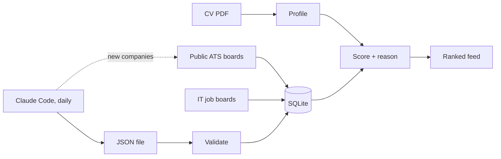

# Job Radar

Upload your CV once, get a ranked feed of matching IT jobs every morning. Jobs come from companies' own career pages and from IT job boards, for Vietnam and remote work.

> **Status:** v2 rewrite in progress: CV upload, sources, scoring, job board and the web search work; the tracker is next.

## What it does

- **Read the CV locally.** Upload a PDF; the app pulls out skills, seniority and location, and you can edit the profile.
- **Find jobs at the source.** Many companies publish their openings through public applicant-tracking boards (Greenhouse, Lever, Ashby, SmartRecruiters). The app reads those directly, so links point to the company itself.
- **Cover the boards too.** Vietnamese IT boards (TopDev, Vieclam24h, CareerLink) and remote boards (RemoteOK, Arbeitnow, We Work Remotely, HN "Who is hiring").
- **Search the web every other day.** A headless Claude Code run looks for official career pages that match the profile and records which board each company uses, so the next crawl reads that company for free.
- **Rank with a reason.** Each job gets a 0–100 score computed locally (skills, location, freshness) with a short "matches / missing" explanation. The same job posted in several places is shown once, preferring the official link.
- **Track applications.** Saved → applied → interview → offer or rejected, with notes.

## How it fits together



## Rules for sources

Only public APIs, RSS feeds and pages that `robots.txt` allows. At most one request per second per host. No bypassing logins, CAPTCHAs or Cloudflare challenges. The review of each source (robots, terms, what is blocked) is in [docs/sources.md](docs/sources.md).

## Stack

- Next.js (TypeScript) for the app and the crawler scripts
- SQLite through Node's built-in `node:sqlite`
- Claude Code in headless mode on an existing Claude Pro plan, every other day; crawl daily with `launchd`
- Runs locally. No paid APIs, no hosting cost

## Run it

```bash
npm install
npm run dev            # http://localhost:3000, upload your CV there
npm run crawl          # fetch jobs from every source (~2 min)
npm run search         # Claude Code web search; skips until the interval set in Settings has passed (--force to run now)
```

"Find jobs" (top right) runs the crawl and the web search now, in the background. The settings dialog next to it sets the theme (dark or light), how many jobs the board shows, the run mode (manual by default; automatic installs a daily launchd agent at the set time), how often the web search runs, its model (any Claude model) and its limits. Every uploaded CV is kept with its name and upload time and can be viewed in a modal or downloaded again. The board sorts by newest found (default), best match or posting date; jobs found by the latest run are tagged New. The web search is told which jobs are already known so it does not spend searches finding them again.

`npm run search` needs the `claude` CLI logged in to a Claude plan. By default it runs Claude Sonnet, asks for at most 8 web searches and 15 page fetches, stops searching once it has 5 jobs it rates 9/10 or better, and is killed at 1.5× those limits; all of these are in Settings. Each run prints the searches, fetches and tokens it used. Claude gets only web search and page fetch; its answer is validated before anything is stored.

## Roadmap

- [x] CV upload and profile review
- [x] ATS sources (Greenhouse, Lever, Ashby, SmartRecruiters)
- [x] Vietnamese and remote board sources
- [x] Dedupe and scoring with reasons
- [x] Job feed and profile UI
- [x] Claude Code web search and import (every other day)
- [x] Daily schedule
- [ ] Application tracker
- [ ] Skill gap view, hide companies, company watchlist

## Part of

The "Now" section of my [portfolio](https://finn-ngn.vercel.app).
